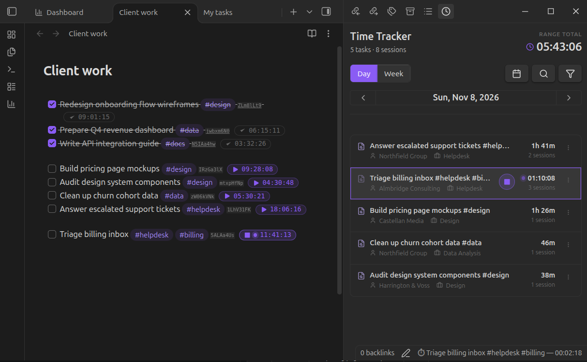
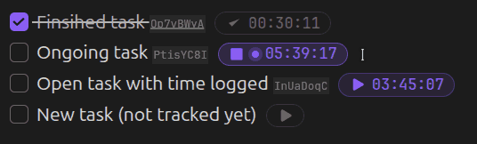
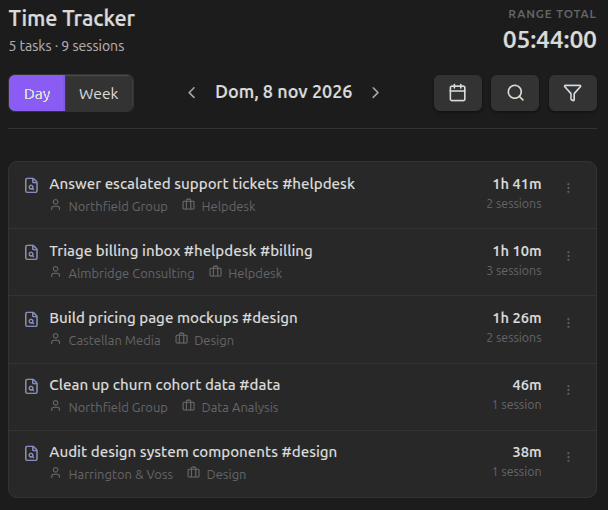

# Task Time Tracker

 

A local-first Obsidian plugin for **tracking time directly on the checkboxes in your notes** — compatible with the Tasks plugin format, with no external services involved at any point.

**Obsidian has no native way to track time on your work**. Existing plugins mostly focus on Pomodoro-style sessions, or don't integrate with the checkbox-based task format already used across vaults — and none of them combine tracking with exporting your time to the tools you already use.

 <a href="https://community.obsidian.md/plugins/task-time-tracker">➔ Install it from the Obsidian Community Plugins directory.</a>

## Contents

- [How it works](#how-it-works)
- [Features](#features)
- [Privacy & architecture](#privacy--architecture)
- [Export](#export)
- [Installation](#installation)
- [Documentation](#documentation)
- [About](#about)
- [License](#license)

## How it works

1. **Open a note** with a checkbox task — no special setup or template required.
2. **Start tracking** from a command or the icon next to the task's checkbox.
3. **Watch the status bar** — a live timer shows the task name and elapsed time as you work.
4. **Stop when you're done** — one click closes the session. Switching tasks does this automatically.
5. **Check off the task — and tracking wraps up on its own**. Marking a task done (or cancelled) stops any active tracking automatically and saves the session, no extra step needed. Reopen the task later and you can pick up tracking again.
6. **Review your history** — sessions grouped by task. Step through Day or Week with the arrows, or open the calendar to jump straight to any date, pick a week, or select a custom range — a range opens a dedicated Results view, sessions grouped by day (most recent first) with a running total. Or search any task by name or `tt-id` across your whole history.

Not seeing the play icon on a task? See [where you can interact with the tracker](https://github.com/Mythanar/obsidian-task-time-tracker/blob/main/docs/tracking.md).

## Features

- **Local-first, always available** — tracking works entirely offline. The plugin never depends on network access for day-to-day use.
- **One timer, no confusion** — only one active timer at a time. Switching tasks closes the previous session automatically, without losing data.
- **Fits your task format** — works with Tasks-style checkboxes (`- [ ]`, `* [ ]`, `+ [ ]`), numbered lists, nested tasks, and checkboxes inside callouts or blockquotes.
- **Plays nicely with Dataview, but never depends on it** — an optional, subtle-by-default identifier keeps your history linked to each task and makes it queryable, without cluttering your notes. → [The task identifier](https://github.com/Mythanar/obsidian-task-time-tracker/blob/main/docs/task-identifier.md)
- **A clear history** — a dedicated panel with per-task cards, day/week navigation or any custom date range, task search by name or `tt-id`, and inline editing or deletion of sessions. → [Search](https://github.com/Mythanar/obsidian-task-time-tracker/blob/main/docs/search.md)
- **Resume tracking without leaving the panel** — start or stop a task's tracking straight from its card in the History panel, without opening the note it lives in. If a task is currently being tracked, any other day where it also has past sessions shows a small marker that jumps you straight back to the live session.
- **Organize with clients & projects** — two separate lists in Settings: give each task a client (who the work is for) and a project (what the work is), independently, then filter the History panel by client, by project, or by both. → [Clients & projects](https://github.com/Mythanar/obsidian-task-time-tracker/blob/main/docs/clients-and-projects.md)
- **A 30-day overview at a glance** — the Dashboard view totals your last 30 days by project, client, day, and task, no filters or setup needed. → [Dashboard](https://github.com/Mythanar/obsidian-task-time-tracker/blob/main/docs/dashboard.md)
- **Export on your terms** — generate a generic CSV or one formatted for Toggl's or Clockify's official importer. You choose when to export — never automatic, never in the background. → [Export](https://github.com/Mythanar/obsidian-task-time-tracker/blob/main/docs/export.md)
- **Zero external API calls** — the plugin never connects to any third-party service, at any point in its operation. Your time data stays in your vault.

## Privacy & architecture

Task Time Tracker never calls an external API — not for tracking, not for exporting, not for anything.

Every session is stored locally in your vault. When you export, the plugin writes a file to disk; nothing is transmitted anywhere. You take that file and upload it yourself, whenever you choose, to the native importer of whichever platform you use.

This isn't a missing feature waiting to be built. It's a deliberate architectural decision: your time data is yours, and it doesn't leave your machine unless you decide to move it. The same philosophy applies to what the plugin puts inside your notes: the task identifier is the only thing it ever writes there, and it stays as unobtrusive as possible by default.

To keep a task linked to its history even if you move or rename its note, the plugin reads across your vault's markdown files looking for its tt-id — this stays entirely on your device, like everything else here, and is never transmitted anywhere. The one-click copy button next to the tt-id in the Edit task dialog uses your operating system's clipboard, exactly like any other copy button you'd find in Obsidian.

## Export

Three export formats are available whenever you need them:

- **Generic CSV** — opens cleanly in any spreadsheet tool.
- **Toggl-formatted CSV** — matches the exact columns expected by Toggl's official importer.
- **Clockify-formatted CSV** — matches the exact columns expected by Clockify's Timesheets importer. Importing time entries into Clockify needs a paid plan or trial — a limitation on Clockify's side, not this plugin's.

*More export formats (Harvest, Everhour, and others) are planned.*

 

For the project and client columns and the Toggl and Clockify limits, see [Export](https://github.com/Mythanar/obsidian-task-time-tracker/blob/main/docs/export.md).

## Installation

**Option A — Obsidian Community Plugins (recommended)**

1. Open Settings → Community plugins in Obsidian.
2. Click Browse and search for "Task Time Tracker".
3. Click Install, then Enable.

**Option B — BRAT** (for beta versions ahead of the official release)
1. Install the [BRAT](https://github.com/TfTHacker/obsidian42-brat) plugin from Community Plugins.
2. In BRAT's settings, add this repository: `Mythanar/obsidian-task-time-tracker`.
3. Enable Task Time Tracker in Community Plugins.

**Option C — Manual**
1. Download `main.js`, `manifest.json`, and `styles.css` from the [latest release](https://github.com/Mythanar/obsidian-task-time-tracker/releases).
2. Create a folder named `task-time-tracker` inside your vault's `.obsidian/plugins/` directory and place the three files there.
3. Reload Obsidian and enable the plugin in Community Plugins.

If you sync your vault across devices, keep Task Time Tracker on the same version on all of them. See [Updating](https://github.com/Mythanar/obsidian-task-time-tracker/blob/main/docs/updating.md).

## Documentation

The [full documentation](https://github.com/Mythanar/obsidian-task-time-tracker/blob/main/docs/README.md) covers each feature in detail:

- [Where you can interact with the tracker](https://github.com/Mythanar/obsidian-task-time-tracker/blob/main/docs/tracking.md)
- [The task identifier](https://github.com/Mythanar/obsidian-task-time-tracker/blob/main/docs/task-identifier.md)
- [Using it with the Tasks plugin](https://github.com/Mythanar/obsidian-task-time-tracker/blob/main/docs/tasks-plugin.md)
- [Clients & projects](https://github.com/Mythanar/obsidian-task-time-tracker/blob/main/docs/clients-and-projects.md)
- [Search](https://github.com/Mythanar/obsidian-task-time-tracker/blob/main/docs/search.md)
- [Dashboard](https://github.com/Mythanar/obsidian-task-time-tracker/blob/main/docs/dashboard.md)
- [Settings](https://github.com/Mythanar/obsidian-task-time-tracker/blob/main/docs/settings.md)
- [Commands](https://github.com/Mythanar/obsidian-task-time-tracker/blob/main/docs/commands.md)
- [Export](https://github.com/Mythanar/obsidian-task-time-tracker/blob/main/docs/export.md)
- [Updating](https://github.com/Mythanar/obsidian-task-time-tracker/blob/main/docs/updating.md)

## About

Built by [Mythanar](https://mythanar.com). This plugin started as something I needed for myself, built alongside AI, because I couldn't find one that did what I actually wanted. If it works for me, maybe it'll work for someone else too.

## License

[MIT](LICENSE)
