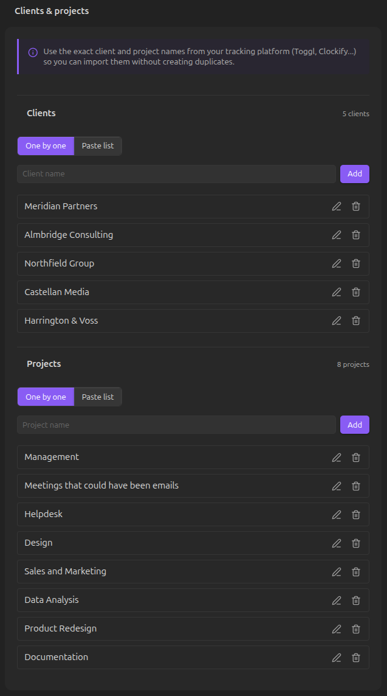
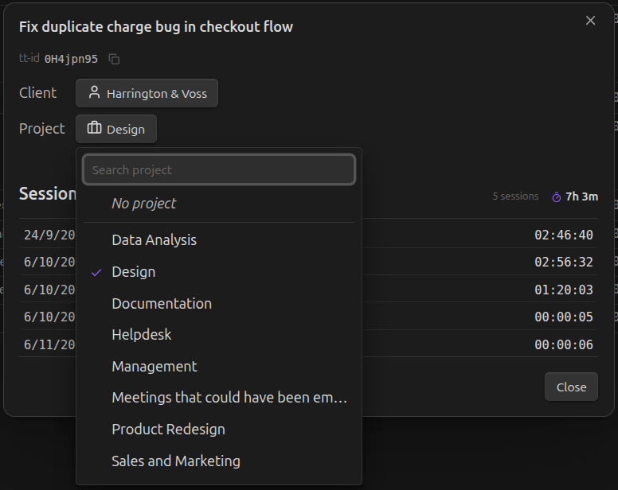
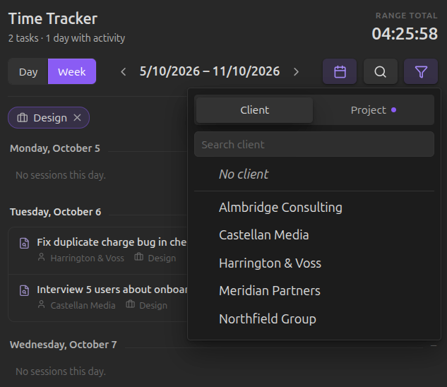
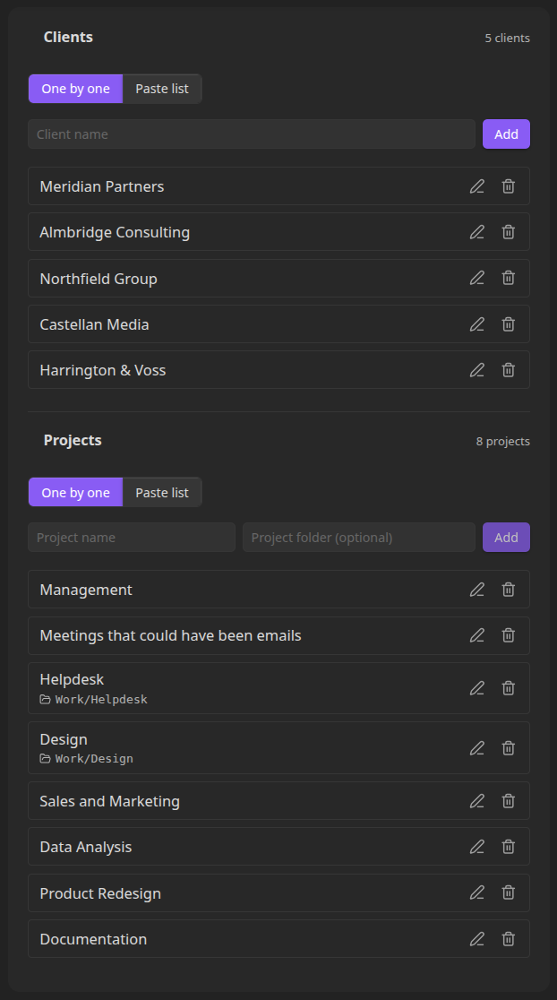
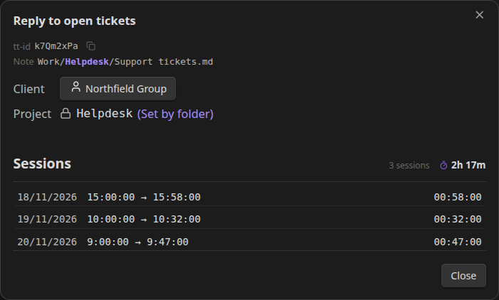

# Clients & projects

Clients and projects are two separate lists in **Settings → Clients & projects**, so the same project can be done for several clients without repeating it: the client is who the work is for, the project is what the work is.

Add clients and projects one by one, or paste a whole list at once (one name per line) if you're migrating from somewhere else: new names are added and the ones already in the list are skipped and listed. Names are unique within each list, ignoring capital letters and extra spaces.

Give any tracked task a client and a project from its **Edit task** dialog — two searchable lists, one for each. A task can have a client without a project, and the other way round.

Filter the History panel with the **Filter** button in its header. Its two tabs, **Client** and **Project**, each list yours with a search box and a "No client" / "No project" row; pick one in each tab to see only the tasks that match both. A dot on a tab means it has a filter on. To remove a filter, press its row again or the **×** on its chip. Filters reset every time you reopen Obsidian, so they're never a setting you forget you left on.

## Project by folder

If you keep one folder per project, link them: give the project a folder in **Settings → Clients & projects** (it's optional). Every task in a note inside that folder, at any depth, gets that project automatically, including its past sessions and your exports. With nested project folders, the deepest one wins.

- **The folder decides.** A task inside a project folder can't get another project by hand: its **Edit task** dialog shows the project with a lock and "(Set by folder)", and a "Note" line shows where the note is. A project you had set by hand isn't lost: it comes back if you remove the folder link.
- **The client stays free.** Folders only set the project; you still choose the client in Edit task.
- **No surprises.** Before you link a folder that changes the project of tasks you already tracked, a dialog tells you how many tasks and how much time. Moving a note into another project's folder shows a notice, and renaming or moving a project folder keeps the link.
- **Export again with care.** If you change projects for dates you already exported, export them again only after checking your platform: most platforms add the entries again instead of updating them. The export dialog reminds you of this.

---

[← Documentation index](README.md) · [Next: Search →](search.md)
