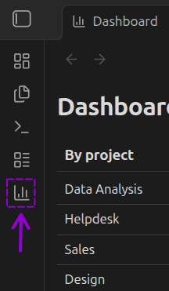
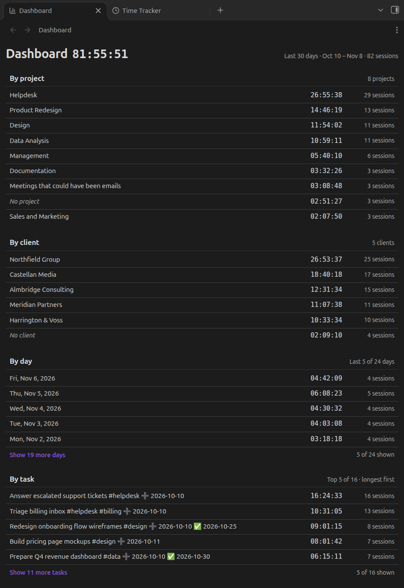

# Dashboard

A dedicated view for a no-filter overview of your last 30 days — opened from its own icon in the ribbon, with the total for the window shown right next to its title and the first and last day it covers below it. The window is always the 30 days up to today, whatever range the History panel shows.

Four blocks share the same row format as the rest of the plugin (name + total time in `HH:MM:SS` + number of sessions):

- **By project** and **by client** — ranked by total time, with a "No project"/"No client" row for anything not assigned.
- **By day** — chronological (most recent first), not ranked, since it's a timeline rather than a leaderboard.
- **By task** — ranked by total time; if a task's source note was deleted, its name still shows (in italics on its History card, upright in Edit task) instead of a generic error, with an explicit "Note not found" and a red icon so it's easy to spot.

Day and task blocks show the top 5 by default, with a "Show all" link loading 50 more at a time. The 30-day window is fixed — no range picker or extra filters, since the four blocks already break the same data down by project, client, day, and task.

---

[← Documentation index](README.md) · [Next: Settings →](settings.md)
