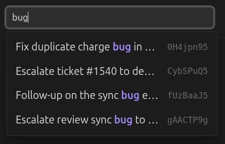

# Search

Find any task from the History panel with the **magnifier icon** in its header. Type part of a task's name or its `tt-id`, and suggestions appear as you type.

- **Pick a suggestion** to see every session of that task, including ones saved under an older name.
- **Press Enter** without picking one to find every task whose name contains what you typed.

Suggestions come from your **entire history**, whatever day or week you were looking at; the results respect any client or project filter you have on. Results open in the Results view, most recent days first.

## Combining filters

Search combines with the client and project filters and the date range. Each active filter shows as its own chip above the results, and each chip has its own **×** to remove just that filter while keeping the rest. For example, search for "invoice" within one client, one project and one month, then drop the month to see that project's matches across all time.

Removing filters never takes you out of the Results view: with the last one gone, it shows your whole history. Without a date range, a "Since" label shows the day of your first session. Use the back arrow to return to Day or Week.

## Full history of a client or project

When a client or project is filtered in Day or Week view, a row under the header shows each filter as a chip with a **View full history** action. It opens the Results view with only those filters, across your whole history, with no date range applied.

---

[← Documentation index](README.md) · [Next: Dashboard →](dashboard.md)
