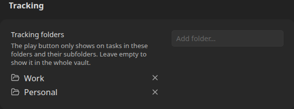

# Settings

The main settings page has the everyday options: Tracking folders, the task identifier format, the Tasks plugin repair and where the History panel opens. **Clients & projects** and **Export** (export folder and the Toggl and Clockify formats) each have their own page, opened from the main one. Obsidian's settings search finds every setting, wherever it lives.

On Obsidian versions before 1.13, everything stays on a single page, as before.

## Tracking folders

Choose the folders where you track time. The play icon only shows on tasks in those folders and their subfolders; elsewhere your notes look exactly as if the plugin wasn't there. The only exception is the task you're tracking right now, which always shows its timer so you can stop it. Leave the list empty to track in the whole vault (the default).

The History panel's play button keeps working for any task, and renaming or moving a listed folder updates the list. If you pick a project folder outside your Tracking folders, Settings warns you and offers to add it.

---

[← Documentation index](README.md) · [Next: Commands →](commands.md)
