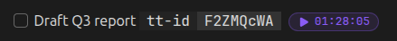
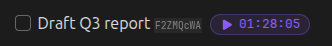

# The task identifier

Every tracked task gets a short, unique identifier stored inline with the task text (`[tt-id:: ...]`), so your history stays linked to the right task even if you edit or move it. Keeping your notes uncluttered matters to us, so this identifier is **subtle by default** — and you're never stuck with how it looks out of the box:

- Go to **Settings → Task identifier format** to choose between **Normal** (fully visible), **Reduced** (small and low-opacity — the default), or **Hidden** entirely.
- This styling requires the [Dataview](https://github.com/blacksmithgu/obsidian-dataview) plugin — Dataview is what renders the identifier at all, so it's also what makes it queryable (e.g. `WHERE tt-id = "..."`) and stylable. **Dataview is entirely optional**: tracking, history, and export all work exactly the same without it.
- Without Dataview installed, the identifier is shown as plain text (e.g. `[tt-id:: a3f9k2mp]`) — this is a known limitation of relying on Dataview for the styling, not a bug.
- In Source mode, the raw identifier is always visible regardless of this setting, so you can always find and inspect it if needed. It's also shown — with a one-click copy button — in the **Edit task** dialog, the quickest way to grab it without switching to Source mode.

**Normal** — shown as Dataview would normally render any inline field.

**Reduced** *(default)* — same information, styled to blend in and stay out of the way while you read your notes.

**Hidden** — the identifier isn't rendered at all, though it's still there in the note and your Dataview queries on `tt-id` keep working.

**Duplicated notes.** If two notes contain the same `[tt-id:: …]` (for example, after duplicating a note), the plugin treats them as a single task: its time still adds up correctly. Which copy's text is shown in the Time Tracker panel, the Dashboard and exports is not defined. The note icon on each card opens the note where the task was last tracked. Avoid duplicating notes that contain tracked tasks.

---

[← Documentation index](README.md) · [Next: Using it with the Tasks plugin →](tasks-plugin.md)
