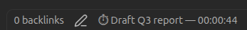

# Where you can interact with the tracker

The play/stop icon and the live counter only appear where Obsidian renders an editable view of the note — that is, in **Edit/Source mode** on the note itself.

They won't appear in any read-only rendering of the task, even though the task and its recorded time are exactly the same underlying data. This includes:
- **Reading mode**
- **Embedded notes** (`![[note#^block]]`)
- **Any query or dataview-style result** (Tasks, Dataview, or similar plugins) — these render a non-editable visualization of the task, not the task itself

To start or stop tracking, switch to Edit mode on the note, or use the **History panel** — which works everywhere, regardless of how the task is normally displayed.

If you set [Tracking folders](settings.md#tracking-folders), the icon only appears on tasks in those folders.

The status bar at the bottom of Obsidian always shows the active task (or "No active tracking"). Clicking anywhere on it opens the History panel — this works regardless of the note's mode, and even with no timer running.

---

[← Documentation index](README.md) · [Next: The task identifier →](task-identifier.md)
